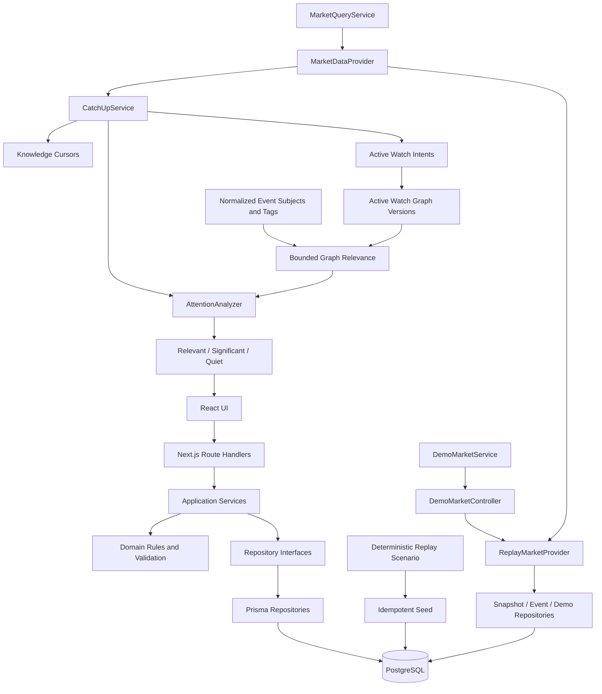
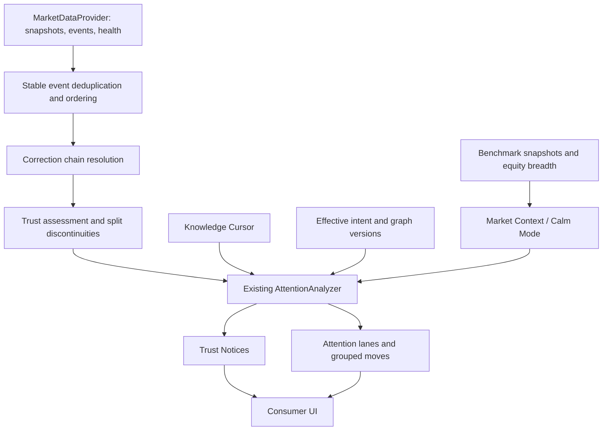
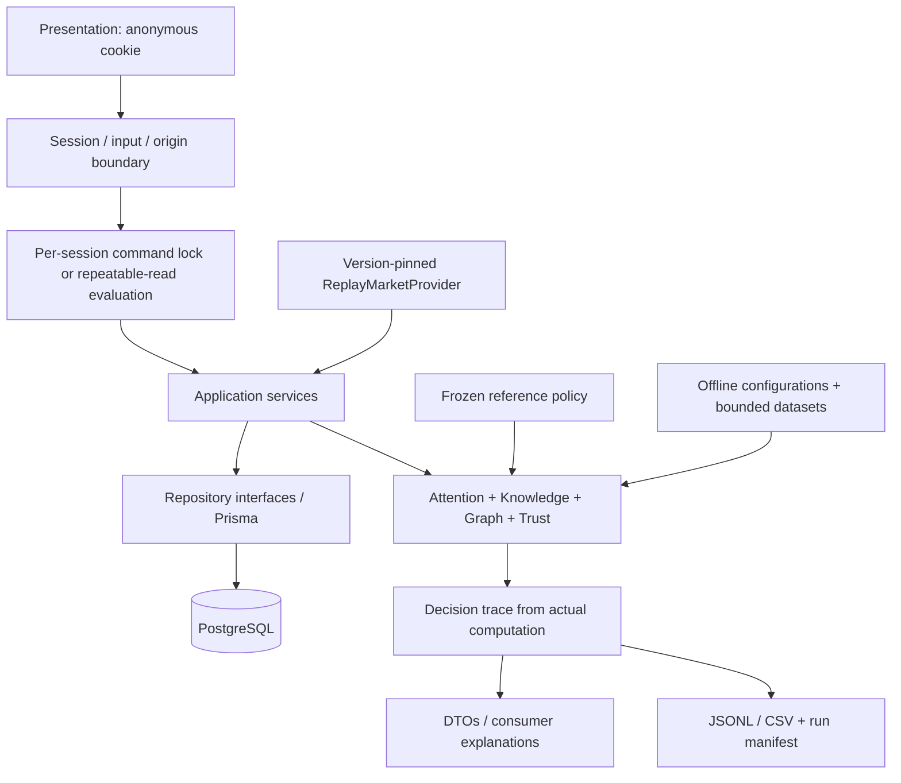

# Architecture

Groww Delta is a modular monolith: one deployable Next.js application with explicit internal boundaries. This keeps local development simple while protecting the domain model from framework, storage, and market-provider details.

## Boundaries

### UI

`src/components` renders DTOs and sends user input through HTTP APIs. It does not access Prisma or replay fixtures. Formatting helpers convert integer paise and normalized timestamps at this boundary.

### Route handlers

`src/app/api` parses query/body data, calls a service, and maps errors to the common JSON envelope. Route handlers contain no watchlist, intent-versioning, or replay rules.

### Application services

`src/server/services` owns use-case rules:

- `WatchlistService`: default-list reads, duplicate prevention, add/archive, and current-sequence cursor baselines
- `WatchIntentService`: payload validation, effective sequence, versioned edit, and archive
- `DemoMarketService`: exact one-step advance, final-step behavior, and cursor-aware reset
- `MarketQueryService`: watchlist snapshots and occurred-event queries
- `InstrumentService`: available instrument queries
- `CatchUpService`: side-effect-free analysis orchestration and explicit acknowledgement
- `WatchGraphService`: curated suggestions plus immutable, market-effective graph versions
- `IntentLifecycleService`: resolution, renewal, keep-watching review, and state-derived timeline queries

### Domain

`src/domain` contains storage-independent rules. The attention analyzer combines cursor windows, snapshots, events, direct intent matches, and bounded Watch Graph matches into one derived item per instrument. Graph validation/traversal and intent lifecycle evaluation have no Prisma, HTTP, React, or replay-fixture dependency.

### Repositories

Repository contracts live in `src/server/repositories/contracts.ts`. Prisma implementations live separately in `prisma-repositories.ts`. Intent supersession plus creation is one database transaction. Cursor advancement uses a conditional database update (`lastSeenSequence < requestedSequence`) and atomically increments its version, so stale acknowledgements cannot regress knowledge.

### Market providers

`MarketDataProvider` defines snapshot, sequence, and event reads. `DemoMarketController` separately defines the persisted scenario control commands. `ReplayMarketProvider` implements both contracts and is the only runtime module that imports replay fixtures. It derives the visible market exclusively from the persisted `DemoSession.currentSequence`; UI and application services never import fixture files.

A future live provider belongs beside `ReplayMarketProvider` and would be selected in `src/server/container.ts`. `CatchUpService` depends only on the provider contract, including bounded snapshot/event reads. Build 2 contains no live-provider code.

## Persistence and concurrency

PostgreSQL is the only source of product state. A partial unique index enforces one active `WatchlistItem` for each watchlist/instrument pair while allowing archived history and later re-addition. Intent and Watch Graph versions keep immutable predecessor links. Graph nodes and edges are relational and loaded through repositories. `KnowledgeAcknowledgement` retains audit history while `KnowledgeCursor` remains current monotonic state. Attention items are not stored: they are reproducibly derived from market facts, active intent/graph versions, and cursor state.

Graph traversal is bounded to three edges and 25 visited nodes. A normalized event subject is authoritative when present; tags provide fallback matching for events without a subject. This lets removal of a specifically tracked subject take effect without a broader context tag silently restoring it.

## Build 4 trust/context flow

Trust logic is under `src/domain/trust`; benchmark policy is under `src/domain/market/context.ts`. CorporateActionService derives authoritative adjustment commands; CorporateActionReviewRepository atomically records decisions and adjusted intent versions. UI renders DTOs and never computes trust or residuals.

Cursor advancement and per-instrument acknowledgement history share one transaction, with deterministic row locks and conditional increments. The acknowledgement command also guards against a replay reset occurring during the command. Scenario reset is a transactional session/cursor update. Scenario/generation namespaces keep replay history separate without weakening the production matcher.

The registry is fixture input behind ReplayMarketProvider. Services request provider data, not scenario-specific attention outcomes. PostgreSQL is still the only source of product state; no cache or extra service was added. See [Build 4](BUILD4.md) for the documentation-only production ingestion evolution.

## Build 5 request and research boundaries

AnonymousSession owns a unique User and DemoSession; mutable records use that user or session ID. Shared market observations are immutable and scenario-version scoped. Routes no longer use demo-user. The legacy container is retained only for offline development scripts.

All request mutations take the session row lock and execute services/repositories in one transaction. Idempotency receipts commit with the mutation. Intent/graph edits accept If-Match and replay advances accept the displayed position token. Read evaluations use RepeatableRead and never acknowledge knowledge. Provisioning a new anonymous identity creates its initial baseline, but existing-session GETs are read-only.

Query-event metrics and allowlisted logs never include SQL, parameters, connection strings or cookies. Decision logs correlate with the request ID and pseudonymous trace session ID. The research CLI has no UI dependency and production has no research-configuration dependency.
